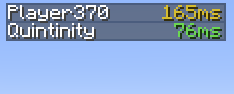

# Better Ping Display

A mod for Minecraft to display each player's ping in the player list as a number. There is also a config file for changing the text color and format.

This is a client-side mod. The server doesn't need to have it installed. It works even when playing on vanilla servers.

## Configuration
This mod's config file is `betterpingdisplay.cfg`. It contains the following options:

| Option            | Default Value  | Description  |
|-------------------|----------------|--------------|
| autoColorText     | `true`         | Whether to color a player's ping based on their latency. E.g, low latency = green, high latency = red |
| renderPingBars    | `false`        | Whether to also draw the default Minecraft ping bars  |
| textColor         | `#A0A0A0`      | The ping text color to use. Only works whens `autoColorText` is false |
| textFormatString  | `%dms`         | The format string for ping text. Must include a `%d`, which will be replaced dynamically by the actual ping value.

## Improvements of this fork
This fork was originally created to open a PR (vladmarica#25) in the [original repository](https://github.com/vladmarica/better-ping-display), which backports the v1.1 changes to the Minecraft 1.7.10 branch.
After more than 2 years without any reaction from the maintainer, I've decided to release these changes myself, making this fork a separate mod (including a different modid).

**Notable improvements** compared to the original v1.0 are:
* Added config file with 4 options
  - Auto-coloring or choosing a specific color of the ping text
  - An option to hide the ping bars
  - Made the ping text customizable

## Development/Support/Maintenance
I am not planning to further update this mod.

However, please open issues if you encounter bugs or incompatibilities/crashes. PRs are also always welcome!
